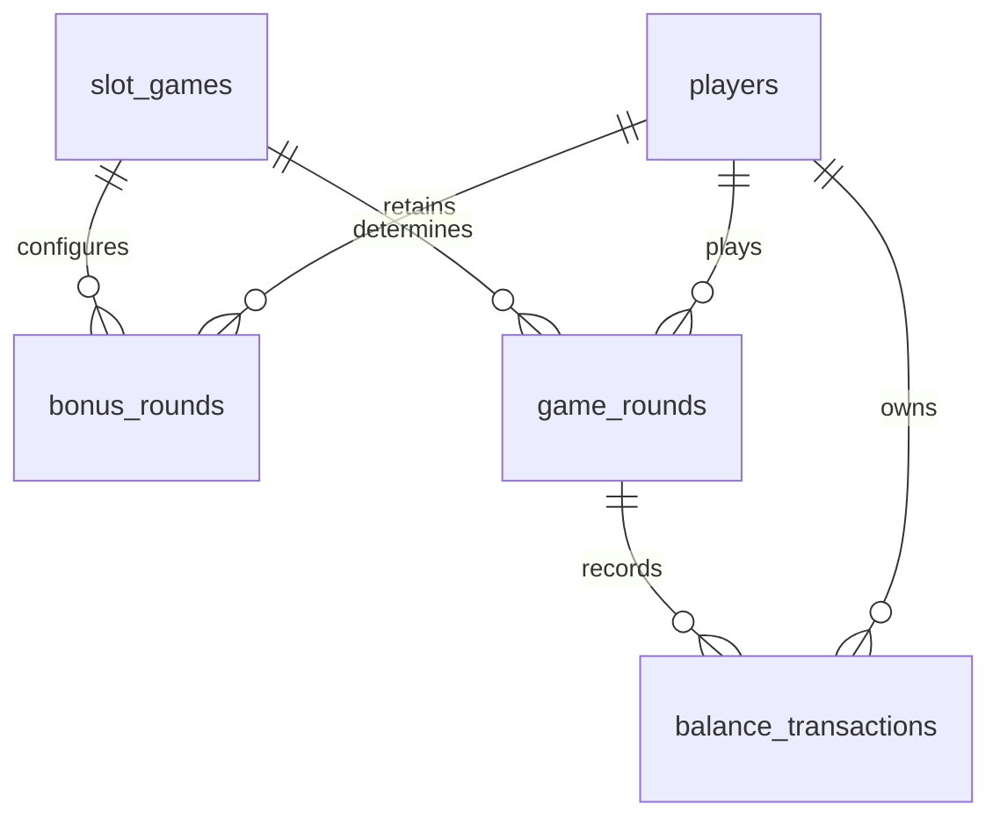

# neiroslop-database

Компонент хранения данных учебного проекта «Виртуальное казино — NEIROSLOP BURMALDA». Репозиторий предназначен для описания PostgreSQL и вспомогательных средств работы с базой. Рабочие данные, пароли и резервные копии в него не входят.

## Место в архитектуре

Браузерный клиент взаимодействует с сервером FastAPI. Только сервер обращается к PostgreSQL через SQLAlchemy и asyncpg. База хранит состояние гостевых кошельков, игровых раундов и бонусов.

| Таблица | Назначение |
| --- | --- |
| `players` | Гостевой идентификатор, баланс и время получения ежедневного подарка |
| `slot_games` | Каталог игр и серверные настройки |
| `bonus_rounds` | Оставшиеся бесплатные вращения и связанная ставка |
| `game_rounds` | Идентификатор запроса, результат, выигрыш и время раунда |
| `balance_transactions` | Начисления, списания ставок и выплаты виртуальных монет |

## Целостность данных

Изменения кошелька, раунда и операций сохраняются одной транзакцией. Блокировка строки игрока согласует конкурентные запросы, а уникальность пары игрока и идентификатора запроса предотвращает повторное списание. Связи таблиц задаются внешними ключами; баланс не может стать отрицательным.

## Границы ответственности

Сейчас источником определений таблиц служит `backend/app/models.py` в репозитории [neiroslop-server](https://github.com/dashkalikov/neiroslop-server). Прототип создаёт отсутствующие таблицы и обновляет каталог из семи игр; версионируемых миграций пока нет. Их выделение в самостоятельный процесс — последующий этап, требующий согласования с сервером.

В опубликованном репозитории вспомогательный скрипт PostgreSQL находится в `scripts/local_database.py`. Он обслуживает отдельный локальный кластер; каталог данных и сгенерированные учётные данные исключены из Git.

## Совместная работа

Изменения структуры данных согласуются с серверной частью и предлагаются через pull request в `main`. Целевые правила требуют одобрения другого участника, повторного одобрения после новых коммитов и закрытия обсуждений. Прямые push в `main`, force push и удаление ветки должны быть запрещены, включая обход администраторами. Правила применяются в настройках GitHub.

CI/CD будет добавлен отдельным этапом.

Общий обзор проекта: [архитектура](docs/architecture.ru.md).
