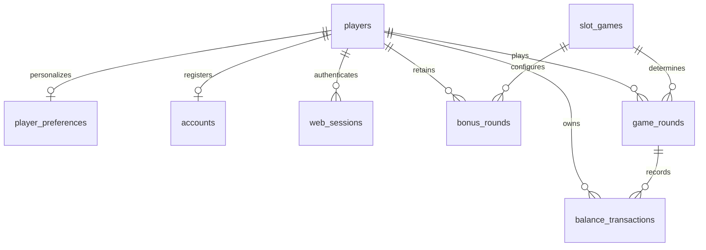

# neiroslop-database

Компонент хранения данных учебного проекта «Виртуальное казино — NEIROSLOP BURMALDA». Репозиторий предназначен для описания PostgreSQL и вспомогательных средств работы с базой. Рабочие данные, пароли и резервные копии в него не входят.

## Место в архитектуре

Браузерный клиент взаимодействует с сервером FastAPI. Только сервер обращается к PostgreSQL через SQLAlchemy и asyncpg. База хранит состояние гостевых кошельков, игровых раундов и бонусов.



| Таблица | Назначение |
| --- | --- |
| `players` | Гостевой идентификатор, баланс и время получения ежедневного подарка |
| `player_preferences` | Имя игрока, цвет аватара и ставка по умолчанию |
| `accounts` | Имя пользователя, хеш пароля, зашифрованный ключ аутентификатора и хеши кодов восстановления |
| `web_sessions` | Хеши токенов сессий и проверок второго фактора, сроки действия и попытки |
| `auth_throttle` | Счётчики и сроки ограничения попыток входа |
| `slot_games` | Каталог игр и серверные настройки |
| `bonus_rounds` | Оставшиеся бесплатные вращения и связанная ставка |
| `game_rounds` | Идентификатор запроса, результат, выигрыш и время раунда |
| `balance_transactions` | Начисления, списания ставок и выплаты виртуальных монет |
| `achievement_claims` | Полученные достижения, уникальные для пары кошелёк и достижение |
| `schema_revisions` | Применённые версии схемы |

## Целостность данных

Изменения кошелька, раунда и операций сохраняются одной транзакцией. Блокировка строки игрока согласует конкурентные запросы, а уникальность пары игрока и идентификатора запроса предотвращает повторное списание. Связи таблиц задаются внешними ключами; баланс не может стать отрицательным.

## Границы ответственности

Сейчас источником определений таблиц служит `backend/app/models.py` в репозитории [neiroslop-server](https://github.com/dashkalikov/neiroslop-server). Сервер применяет ревизии из backend/app/core/migrations.py и обновляет каталог. Первая ревизия принимает существующую схему; вторая создаёт achievement_claims и составные индексы истории по кошельку и дате. Таблица schema_revisions хранит применённые версии.

В опубликованном репозитории вспомогательный скрипт PostgreSQL находится в `scripts/local_database.py`. Он обслуживает отдельный локальный кластер; каталог данных и сгенерированные учётные данные исключены из Git.

## Резервное копирование и восстановление

Для локальной базы из Compose создайте архив PostgreSQL на компьютере, с которого запускаете Docker. Имя файла ниже должно быть свободно.

```sh
docker compose exec -T db pg_dump -U neiroslop -d neiroslop -Fc -f /tmp/neiroslop-demo.dump
docker compose cp db:/tmp/neiroslop-demo.dump ./neiroslop-demo.dump
```

Для проверки восстановления создайте отдельную пустую базу и загрузите архив в одной транзакции. Эти команды рассчитаны на Linux-контейнеры из корневого Compose.

```sh
docker compose cp ./neiroslop-demo.dump db:/tmp/neiroslop-demo.dump
docker compose exec -T db createdb -U neiroslop neiroslop_restore
docker compose exec -T db pg_restore -U neiroslop -d neiroslop_restore --exit-on-error --single-transaction /tmp/neiroslop-demo.dump
docker compose exec -T db psql -U neiroslop -d neiroslop_restore -c "SELECT version FROM schema_revisions ORDER BY version;"
```

Храните архивы вне репозитория. Вместе с базой сохраните отдельно действующий `AUTH_SECRET_KEY` или файл ключа из тома `auth_data`: он нужен для расшифровки данных аутентификаторов. Для рабочей базы применяйте штатный план резервного копирования и проверяйте восстановление на отдельном экземпляре PostgreSQL.

## Совместная работа

Участники согласуют изменения структуры данных с серверной частью и предлагают их через pull request в `main`. Для них требуется одобрение другого участника, повторное одобрение после новых коммитов и закрытие обсуждений; прямые push в `main`, force push и удаление ветки запрещены. Владелец личного репозитория может обходить защиту, напрямую отправлять изменения в `main` и сливать pull request без чужого одобрения. Правила применяются в настройках GitHub.

Сборка, тестирование и запуск контейнеров описаны в docs/ci-cd.md.

Общий обзор проекта: [архитектура](docs/architecture.ru.md).
