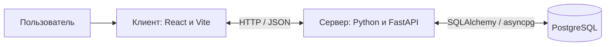

# Виртуальное казино — NEIROSLOP BURMALDA

Учебный веб-проект с игровыми автоматами, виртуальными монетами и тематическим интерфейсом. Пользователь выбирает игру, делает ставку, получает результат раунда и просматривает историю. Монеты не имеют денежной стоимости: покупка, вывод средств и игра на реальные деньги не предусмотрены.

Проект объединяет девять игр: Riviera Roulette, Saloon Luck, Big Bass Bonanza, Goldrush Canyon, Velvet Sevens, Moonlight Magic, Temple of Gold, Neon Nights и Ocean Myth. Интерфейс поддерживает светлую и тёмную темы, выбор фона, звуковое сопровождение, автоматические вращения и адаптацию к мобильным устройствам.

## Запуск одной командой

В корне проекта запустите эту команду при работающем Docker в режиме Linux-контейнеров.

```sh
docker compose up --build --wait
```

Compose соберёт React и FastAPI, запустит PostgreSQL и дождётся готовности сервисов. Откройте [приложение](http://127.0.0.1:8000/). Команда `docker compose down` останавливает сервисы и сохраняет данные PostgreSQL.

[Параметры локального запуска и CI/CD](https://github.com/dashkalikov/neiroslop-client/blob/main/docs/ci-cd.md#run-locally-with-linux-containers).

## Архитектура

Приложение состоит из трёх самостоятельных частей: браузерного клиента, сервера API и базы данных PostgreSQL.



| Компонент | Ответственность |
| --- | --- |
| Клиент | Каталог игр, навигация, анимация, настройки оформления и звука, отображение баланса и результатов |
| Сервер | Гостевые сессии, проверка ставок, игровые правила, расчёт выигрышей, бонусы и история раундов |
| База данных | Хранение игроков, каталога игр, бонусного состояния, раундов и операций с виртуальным балансом |

Клиент отправляет выбранную игру, ставку и уникальный идентификатор запроса. Сервер проверяет запрос, рассчитывает результат и сохраняет изменения одной транзакцией. Клиент показывает полученный результат; итоговый баланс и выигрыш определяет сервер.

Повторный запрос с тем же идентификатором возвращает уже сохранённый результат без повторного списания ставки. Блокировка кошелька на время транзакции защищает баланс при одновременных запросах. Браузер не подключается к PostgreSQL напрямую.

## Организация репозиториев

Проект разделён на три публичных репозитория:

| Репозиторий | Содержимое |
| --- | --- |
| [neiroslop-client](https://github.com/dashkalikov/neiroslop-client) | React-приложение, графика, звук, клиентские проверки и конфигурация Vite |
| [neiroslop-server](https://github.com/dashkalikov/neiroslop-server) | FastAPI-приложение, игровые правила, модели SQLAlchemy и серверные проверки |
| [neiroslop-database](https://github.com/dashkalikov/neiroslop-database) | Описание структуры данных и вспомогательные средства для PostgreSQL |

[Общая доска NEIROSLOP](https://github.com/users/dashkalikov/projects/1/views/1) объединяет задачи и pull request из всех трёх репозиториев. Репозитории размещены в личном аккаунте `dashkalikov`; доступ предоставляется отдельно к каждому репозиторию.

Граница между сервером и базой данных проходит по соединению с PostgreSQL. Сейчас определения таблиц находятся в серверных моделях SQLAlchemy. Репозиторий базы данных описывает структуру хранения и содержит вспомогательные средства; отдельной системы версионируемых миграций пока нет.

## Работа команды

Целевая модель разработки — короткие рабочие ветки `feature/*`, `fix/*`, `docs/*` и pull request в `main`. Для слияния требуется как минимум одно одобрение другого участника с правом записи. После новых коммитов требуется повторное одобрение; обсуждения должны быть закрыты.

Для участников защита `main` запрещает прямые push, принудительную перезапись истории и удаление ветки. Владелец личного репозитория может обходить защиту: напрямую отправлять изменения в `main` и сливать pull request без чужого одобрения, в том числе для срочных исправлений. Управление доступом и настройками остаётся у владельца. Фактические правила задаются в настройках GitHub.

## Текущее состояние

Реализованы гостевые кошельки, серверный расчёт игровых раундов, сохранение истории, ежедневный подарок, игровые бонусы и личный кабинет с сохранением профиля. Проект остаётся учебным прототипом: регистрация пользователей, версионируемые миграции и производственная эксплуатация относятся к дальнейшему развитию.

Интеграционный конвейер GitHub Actions проверяет приложение, собирает и запускает Linux- и Windows-образы, публикует релизные образы в GHCR и поддерживает развёртывание Linux-версии. [Структура конвейера, команды запуска и настройка выпуска](https://github.com/dashkalikov/neiroslop-client/blob/main/docs/ci-cd.md).

## Saloon Luck

Отдельная игра по присланному эскизу механического автомата: детализированный бронзовый корпус, неоновые стеклянные лампы, три живых барабана, кристальный рычаг, подсветка кнопок, выпуклое стекло барабанов и лоток с монетами. Три кристалла BONUS дают 8 бесплатных вращений с удвоенными линейными выигрышами. Ставка вводится вручную; доступны автоспин, таблица выплат, история и увеличение корпуса. Наклонные кнопки на корпусе дополнены современной панелью справа с общей ставкой и состоянием игры. Удлинённый резной рычаг меняет перспективу при движении и вращает шестерни; лампы, неон и искры анимированы, подсветка плавно исчезает до прозрачности. Сервер сохраняет результаты и баланс в PostgreSQL.

Игра: `http://127.0.0.1:3000/#game/saloon`. [Графика и описание реализации](https://github.com/dashkalikov/neiroslop-client/blob/main/docs/saloon-luck.md).

## Riviera Roulette и личный кабинет

Riviera Roulette — отдельная европейская рулетка с вращающимся колесом, шариком, интерактивными фишками, ставками на номера и внешние поля, отменой размещения и повторением предыдущих ставок. Результат определяет FastAPI; PostgreSQL сохраняет раунд и баланс. Повтор запроса и восстановление раунда после перезагрузки не списывают ставку повторно.

В каталоге доступны категории «Все игры», «Слоты», «Механические» и «Настольные игры». В разделе My account можно изменить имя, цвет аватара и ставку по умолчанию, управлять оформлением и звуком, а также просматривать историю. Профиль сохраняется с гостевым кошельком; настройки оформления — на устройстве.

[Правила, архитектура и графика](https://github.com/dashkalikov/neiroslop-client/blob/main/docs/roulette-and-account.md). Игра: `http://127.0.0.1:3000/#game/roulette`. Личный кабинет: `http://127.0.0.1:3000/#account`.

### Трёхмерная модель колеса

Колесо Riviera Roulette построено из отдельных объёмных деталей: корпус, подшипник, дорожка, отражатели шарика, карманы, кольцо номеров, чаша, турель и шарик. В Explore the craftsmanship доступны разборка, выделение отдельной детали, вращение модели и масштабирование. Корпус неподвижен, центральный ротор вращается независимо. [Конструкция, материалы и проверки](https://github.com/dashkalikov/neiroslop-client/blob/main/docs/roulette-wheel-model.md).
